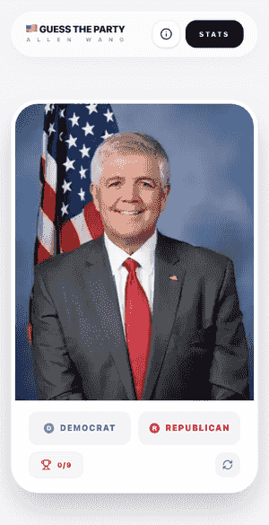
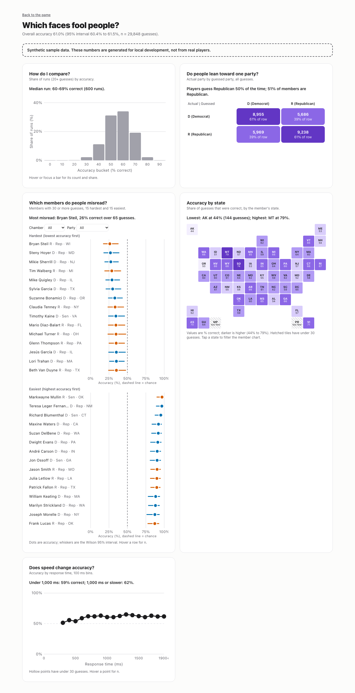

# Guess the Party

A swipe game that shows the official portrait of a member of Congress and asks you to guess whether they are a Democrat or a Republican.





The screenshot above shows the labeled synthetic sample, not real players.

## How it works

**Dataset.** `scripts/build_dataset.py` reads `legislators-current.json` from the [congress-legislators](https://github.com/unitedstates/congress-legislators) project, keeps Democrats and Republicans, downloads each portrait from [unitedstates/images](https://github.com/unitedstates/images), and writes `public/politicians.json` (keyed by bioguide id) and `public/meta.json` (generation time, sources, counts). It logs every skipped member with a reason and exits with an error when more than 5% of D and R members are missing. `scripts/optimize-images.mjs` then converts the portraits to 360x440 WebP. A weekly GitHub Action runs both and opens a pull request when the roster changes.

**Game loop.** `hooks/useGame.js` deals cards from a pure reducer (`lib/game-queue.js`) that shuffles with Fisher-Yates and keeps the last 50 members out of the next deal. A guess locks input until the next card, the reveal timer is cleared on reset, and response time starts when the portrait finishes loading. Progress, streaks and trophies stay in `localStorage`.

**Stats API.** Runs and guesses go to Upstash Redis through three Next.js API routes:

- `POST /api/submit-score` takes `{ runId, correct, total }` at 20 guesses and then once per 25 more. The server computes accuracy, rejects runs under 20 or over 5,000 guesses and impossible counts, and stores one histogram bucket per run id, so a resubmitted run moves between buckets instead of counting twice. Bucket writes happen in one `MULTI`.
- `POST /api/guesses` takes batches of up to 10 `{ bioguideId, guessedParty, responseMs }`. The server looks up the member's party itself, rejects unknown ids, and increments per-member, per-state and per-100 ms counters in one pipeline.
- Both routes share a rate limit of 30 requests per 10 minutes, keyed by a salted SHA-256 of the client IP.
- `GET /api/insights` returns aggregates only: no IPs and no run ids.

**/insights.** One page answers four questions: how a run compares with others, which members people misread (Wilson 95% intervals, members with fewer than 30 guesses hidden), whether players lean toward guessing one party, and whether answer speed changes accuracy. Each chart prints a takeaway computed from the data and shows "Not enough games yet" until it has 30 observations.

**/daily.** Ten faces chosen by a PRNG seeded with the UTC date, the same for every player that day, with a copyable result grid. A civics class can play it together and then open /insights to discuss which faces people misread.

**Decks.** A picker under the header switches between the current Congress (the default), the 117th, 118th and 119th Congresses, and the Class of 2026 (new members of the 120th, both parties or Democrats only). `scripts/build_decks.py` writes them to `public/decks/`. Congress decks use each member's party in that Congress and the official portraits. Class of 2026 photos come from Wikimedia Commons, since official portraits do not exist before swearing-in, and each card credits the photo's author and license on reveal. Each deck keeps its own local stats; only the default deck reports to the global stats API and unlocks trophies.

## Quickstart

Requires Node 20 or later.

```bash
npm ci
npm run dev
```

Open http://localhost:3000. To store stats in Upstash Redis, set either pair of variables (the second pair is what the Vercel marketplace integration creates):

- `UPSTASH_REDIS_REST_URL` and `UPSTASH_REDIS_REST_TOKEN`
- `KV_REST_API_URL` and `KV_REST_API_TOKEN`

Optionally set `IP_HASH_SALT`; without it each server process picks a random salt.

Without Upstash variables the API keeps stats in server memory. The game plays normally, the stats reset when the server restarts, and each /insights view shows "Not enough games yet" until it has 30 observations. To see /insights with data locally, run `npm run dev:sample`: it seeds the in-memory store with 600 synthetic players, and the page shows a "Synthetic sample data" banner.

Tests:

```bash
npm run lint
npm run format:check
npm test
npm run build
npx playwright install chromium
npx playwright test
```

## Rebuilding the dataset

```bash
python3 -m venv .venv
.venv/bin/pip install -r requirements.txt
.venv/bin/python scripts/build_dataset.py --dry-run
.venv/bin/python scripts/build_dataset.py
node scripts/optimize-images.mjs
```

`--dry-run` fetches the roster and prints counts without writing anything. It does not check whether portraits exist upstream, so the real run can skip members that the dry run counted.

## Results

The current snapshot holds 450 members: 221 Democrats (177 House, 44 Senate) and 229 Republicans (183 House, 46 Senate). Its `generated_at` in `public/meta.json` is 2025-12-19, the date of the commit that added it, because the original scraper did not record when it ran. A dry run on 2026-11-11 found 536 current D and R members, so the snapshot is behind.

Converting the portraits to WebP took `public/images/politicians` from 64.6 MB to 4.8 MB (450 files each way).

Player results live on the deployed site's /insights page. This README does not quote them, because they change with every game and no snapshot of the production store was taken for this revision.

## Limitations

- Only Democrats and Republicans appear; independents are excluded.
- The roster is a snapshot and ages until the weekly refresh pull request is merged.
- Portraits can leak cues unrelated to the face, such as background, lighting, clothing, or the era of the photo.
- Players choose to play and choose when to stop, so the aggregates describe this game's players, not the public.
- The rate limit slows abuse but cannot stop a determined client from sending made-up guesses.

## License

The code is under the [MIT License](LICENSE). The portraits come from the [unitedstates/images](https://github.com/unitedstates/images) project, which collects official public-domain photographs of members of Congress.
